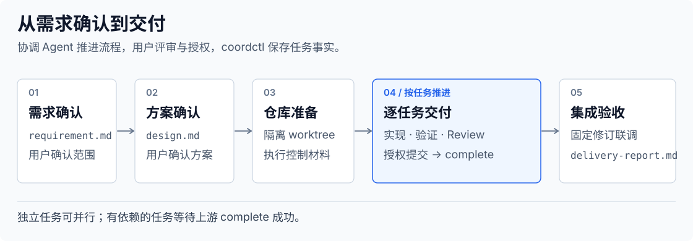
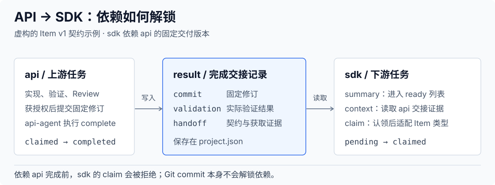

# Agent Delivery Kit

组织 AI 编码 Agent 从需求到代码交付，支持跨仓库协作、人工评审和跨会话续接。

一个需求涉及多个仓库时，常常需要反复解释：每个 Agent 改什么、哪个任务可以开始、上游交付了哪个版本、上次评审停在哪里。Agent Delivery Kit 将这些信息保存在本地，让不同 IDE、CLI 或独立会话中的 Agent 按同一份需求和方案继续工作。



需求和方案分别确认后，再准备仓库和执行控制材料。各任务按实际范围评审、验证和授权提交；全部任务结束后，进行集成验收并汇总交付结果。

## 适用场景

适合需要协调多个编码 Agent 的技术负责人和工程师，尤其是以下场景：

- 一个需求同时修改 API、SDK 或其他业务仓库，需要明确先后依赖和交付版本。
- 多个 IDE / CLI 会话分别处理不同任务，需要共享边界、进度和评审结果。
- 工作中断或更换 Agent 后，需要从已有记录恢复，保留原任务的认领和交接事实。

项目不绑定模型、IDE 或企业需求系统。Agent 由使用者所在的环境运行，用户参与需求、方案和代码评审，并按实际范围授权提交及发布。

## 核心能力

| 能力 | 解决的问题 |
|---|---|
| 需求、方案与逐项评审 | 用固定文档保留交付范围、确认依据和评审结果，减少反复传递上下文 |
| 任务认领与依赖检查 | 依赖满足后才能开始下游任务，同一任务的并发认领只有一个成功 |
| 跨仓库交接 | 保存上游的固定修订、验证结果和使用说明，让下游按确切版本继续 |
| 跨会话续接 | 本地文件保留任务状态和设计偏离；新的会话核对记录后，可继续原任务 |

## 运行要求

- **CLI**：Go 1.23 或兼容工具链，支持 Unix `flock` 的系统，以及可读写的共享本地文件系统。Windows 尚未验证。
- **交付流程**：能阅读 Markdown、读写授权文件和执行命令的编码 Agent，以及参与评审和确认的用户。
- **业务仓库**：Git、对应语言工具链、可获取的依赖和任务所需的隔离验证环境。

项目 Skills 保存在 `skills/`，由 Agent 直接读取。无需安装外部 Skills 或自定义 Agent；可使用通用子 Agent、独立会话，也可由一个执行者按依赖顺序串行处理。`agents/` 中的专业角色 prompt 是可选增强项，具体配置见 [Agent 委派与可选角色配置](skills/delivery-flow/references/agent-delegation.md)。

## 快速开始

### 1. 安装入口 Skill

以下方式任选一种，只安装 [agent-delivery-kit 入口 Skill](skills/agent-delivery-kit/SKILL.md)。完整工具包在首次初始化时获取，也可以复用现有检出。

#### 用 `npx skills` 安装

推荐全局安装，安装后可在支持该安装位置的 Agent 中跨项目使用。需要 Node.js 22.20 或更新版本。

```bash
npx skills add near-notfaraway/agent_delivery_kit --skill agent-delivery-kit -g
```

#### 让 Agent 安装

> 请从 `https://github.com/near-notfaraway/agent_delivery_kit` 全局安装 `agent-delivery-kit` Skill。

#### 按 Agent 的方式手动安装

在 Agent 的 Skill 管理界面导入 `skills/agent-delivery-kit/SKILL.md`，或按其文档将 `skills/agent-delivery-kit/` 复制到它识别的 Skill 目录。

### 2. 让 Skill 初始化

按你的 Agent 支持的方式选择 `agent-delivery-kit`，或在对话中直接点名：

> 用 `agent-delivery-kit` Skill 初始化。

Skill 会在首次初始化时将完整工具包检出到 `~/.local/share/agent-delivery-kit`，再编译并试运行 `coordctl`。如果已有本地检出，可以在初始化时指定目录。默认使用通用 Agent；想配置需求设计、评审或验收 Agent 时，在同一轮告诉它。各阶段 Skills 由交付流程从工具包中按需读取。

### 3. 启动或续接需求

使用同一个入口，发出本次请求即可：

> 用 `agent-delivery-kit` Skill 交付新需求。原始需求：……。涉及仓库：……。

> 用 `agent-delivery-kit` Skill 继续处理需求，需求目录 `/absolute/path/to/requirement-directory`。这次继续：……。

不支持安装 Skill 或临时试用时，可以让 Agent 直接读取 `/absolute/path/to/agent_delivery_kit/skills/agent-delivery-kit/SKILL.md`，再附上初始化、新需求或续接请求。

### 4. 按阶段评审与确认

1. 审阅 `requirement.md`，确认本次范围、业务规则和验收条件。
2. 需求确认后审阅 `design.md`，确认实现方案；协调 Agent 随后在授权范围内准备仓库和执行材料。
3. 开发中按任务和里程碑评审具体差异与验证结果，并按实际范围授权提交；全部任务结束后进行集成验收。推送、PR、合并和部署分别核对授权。

## 交付材料

材料默认保存在被 Git 忽略的 `workspaces/<需求名>/`，按阶段生成：

| 材料 | 用途 |
|---|---|
| `requirement.md` / `design.md` | 需求与方案的人工评审入口 |
| `delivery.json` | 协调者维护的整体进度、确认记录和当前交付修订 |
| `control/` | 执行说明、任务图、确认基线及需求独立的 CLI |
| `reviews/` / `validation/` | 各任务的评审结论、验证结果和必要证据 |
| `repos/` | 各业务仓库的隔离 worktree |
| `delivery-report.md` | 最终交付结果、各仓库修订及下游交接说明 |

恢复已有需求时沿用原材料位置。真实需求材料和本地状态不应提交到工具包的公开仓库。

## 使用边界

- 只支持共享本地文件系统上的协调，跨机器协作尚未验证。
- 没有任务租约、心跳、超时回收和自动重试；中断后按 [恢复约定](skills/delivery-flow/references/recovery-and-corrections.md) 继续。
- CLI 不会启动或托管 Agent，也不自动生成文档或落实人工评审、提交及发布授权。
- `needs_approval` 只记录审批要求，尚未形成强制门禁；修订和证据字段的真实性仍需实际核验。
- 认领只保证同一任务的并发所有权；多个任务修改同一 worktree 时，仍须由协调者安排唯一 writer。

## 使用文档

| 文档 | 用途 |
|---|---|
| [agent-delivery-kit](skills/agent-delivery-kit/SKILL.md) | 首次配置、新建或续接需求的用户入口 |
| [delivery-flow](skills/delivery-flow/SKILL.md) | 完整交付、调度与跨会话恢复入口 |
| [requirement-analysis](skills/requirement-analysis/SKILL.md) / [需求模板](skills/requirement-analysis/assets/requirement_template.md) | 需求整理与确认 |
| [technical-design](skills/technical-design/SKILL.md) / [方案模板](skills/technical-design/assets/design_template.md) | 技术设计与方案评审 |
| [repository-preparation](skills/repository-preparation/SKILL.md) | 基线核查与 worktree 准备 |
| [delivery-review](skills/delivery-review/SKILL.md) / [integration-validation](skills/integration-validation/SKILL.md) | 单任务评审与跨仓库验收 |
| [Agent 委派与可选角色配置](skills/delivery-flow/references/agent-delegation.md) | 执行者职责、调用输入与专业角色配置 |
| [验证与证据](skills/delivery-flow/references/validation-and-evidence.md) / [产物管理](skills/delivery-flow/references/artifact-management.md) | 验证标准、替代路径与资源管理 |
| [CLI 文档](docs/cli.md) | 命令、控制文件字段、输出和退出码 |

## 工作原理

工具包由 Markdown Skills、文档模板和 Go CLI `coordctl` 组成。协调 Agent 按 Skills 整理需求、推进评审并安排任务；`coordctl` 保存任务状态、检查依赖并提供上游交接上下文。

CLI 负责持久化任务事实；评审、验证和授权门禁由 Agent 按 Skills 落实。[控制文件模板](templates/project.template.json)提供了 version 1 的空任务图，实际任务图按确认方案生成。

### 任务与交接示例

以虚构的 Item v1 契约为例：`api` 先发布稳定的 `id` 和 `name` 字段，`sdk` 再按该固定契约适配公开类型。SDK 任务依赖 API 任务。



下面展示 version 1 的任务图。任务 ID 使用仓库别名，路径需替换为实际授权 worktree；示例不代表需求、方案或提交已经获批。

```json
{
  "version": 1,
  "name": "item-contract",
  "tasks": [
    {
      "id": "api",
      "repo": "/absolute/path/to/requirement/repos/api",
      "title": "api：发布 Item v1 契约",
      "objective": "定义稳定的 id 和 name JSON 字段",
      "acceptance": ["契约测试通过，JSON 字段名保持稳定"],
      "handoff_requirements": ["固定提交、契约版本及获取方式"],
      "depends_on": [],
      "status": "pending"
    },
    {
      "id": "sdk",
      "repo": "/absolute/path/to/requirement/repos/sdk",
      "title": "sdk：适配 Item 类型",
      "objective": "按 api 的固定契约版本实现公开类型",
      "acceptance": ["SDK 序列化与上游契约一致"],
      "handoff_requirements": ["固定提交、验证结果及下游使用说明"],
      "depends_on": ["api"],
      "status": "pending"
    }
  ]
}
```

初始 `summary` 的 `ready` 列表只有 `api`。API 任务认领、实现、验证、评审并获提交授权后，提交获批内容，再用真实修订和验证结果执行 `complete`。CLI 保存的任务字段片段如下，尖括号内容需替换为真实值：

```json
{
  "id": "api",
  "status": "completed",
  "owner": "api-agent",
  "result": {
    "commit": "<已验收的完整 Git SHA>",
    "validation": ["<实际运行的契约测试及结果>"],
    "handoff": "<Item v1 的固定依赖版本、获取方式及验证证据>"
  }
}
```

随后重新运行 `summary`，`sdk` 进入 `ready` 列表；`context --task sdk` 返回 SDK 的任务边界及 API 的完成证据。SDK 任务成功 `claim` 后，按上游固定版本继续实施。完整命令见 [CLI 文档](docs/cli.md)。

`ready` 是根据任务状态和依赖计算出的可开始列表，任务此时仍为 `pending`。Git commit 本身不解锁依赖，必须成功执行 `complete`；活跃任务状态通过 CLI 修改，不能直接套用示例编辑控制文件。

## 开发与共创

### 构建并试运行 CLI

克隆仓库后，在项目根目录执行：

```bash
CLI_DIR="$(mktemp -d "${TMPDIR:-/tmp}/agent-delivery-kit-cli.XXXXXX")" &&
go build -o "$CLI_DIR/coordctl" ./cmd/coordctl &&
"$CLI_DIR/coordctl" summary --project templates/project.template.json
```

空任务模板的输出为：

```json
{
  "counts": {},
  "ready": []
}
```

构建使用 Go 默认缓存；需要指定缓存位置时，在当前会话设置 `GOCACHE` 为可写的绝对路径。已有配置直接沿用，同一交付的后续构建使用相同配置，不要求创建固定名称或位置的缓存目录。

这一步只检查 CLI 是否可运行。试运行二进制位于 `$CLI_DIR`，用完可删除该临时目录；正式交付使用需求独立的控制目录和二进制。命令、控制文件字段和退出码见 [CLI 文档](docs/cli.md)。

### 项目进展

当前已具备本地需求交付所需的流程、模板和 CLI，并完成真实跨仓库交付验证。

| 范围 | 当前完成情况 |
|---|---|
| 需求交付流程 | 需求与方案确认、仓库准备、任务执行、逐项评审、跨仓库交接和本地集成验收已验证 |
| 全新环境使用 | 不配置自定义 Agent、不安装外部 Skills，使用通用执行者完成交付已验证 |
| 产物管理 | 材料准入、证据保留与复用、临时资源处理约定已在实际执行中验证 |
| CLI 与自动化回归 | version 1 的认领、依赖、完成证据、上下文、决策、跳过和状态汇总已实现，已有测试覆盖这些核心行为及并发认领 |

后续重点是将 CLI 独立进程的状态恢复与并发认领检查纳入自动化回归，并根据不同使用者的实际交付继续完善流程、评估效率收益。能力演进依据实际缺口和验证证据，当前范围保持为本地交付工具包。

### 反馈与贡献

欢迎通过仓库 Issues 提交使用问题、缺陷和真实复用反馈，通过 Pull Request 提交改进。问题报告请包含工具链、复现步骤、预期与实际结果，并使用可公开的虚构任务数据。

贡献前阅读 [AGENTS.md](AGENTS.md)。当前优先处理正确性、兼容性、已有行为的测试和使用文档改进；功能扩展需有实际使用依据。

## 许可证

采用 [MIT License](LICENSE)。
